# Diagrama de clases

```mermaid
classDiagram
    class Stand {
        <<abstract>>
        -String codigo
        -double largo
        -double ancho
        -Zona zona
        -EstadoStand estado
        #double PRECIO_BASE_M2
        +calcularPrecio()* double
        +getTipo()* String
        +calcularMetrosCuadrados() double
        +estaDisponible() boolean
        +reservar() void
        +ocupar() void
        +liberar() void
        +ponerEnMantenimiento() void
    }
    class StandGastronomico {
        -double CARGO_SERVICIOS
        +calcularPrecio() double
        +getTipo() String
    }
    class StandArtesanal {
        -double DESCUENTO_ARTESANO
        +calcularPrecio() double
        +getTipo() String
    }
    class StandComercial {
        -double RECARGO_UBICACION
        +calcularPrecio() double
        +getTipo() String
    }
    class Expositor {
        -String nombre
        -String correo
        -String telefono
        -String giro
    }
    class Reserva {
        -int id
        -LocalDate fecha
        -EstadoReserva estado
        +calcularAnticipo() double
        +calcularSaldo() double
        +confirmar() void
        +cancelar() void
    }
    class MetodoPago {
        <<interface>>
        +procesar(double monto) boolean
        +getNombre() String
    }
    class PagoTarjeta {
        -String ultimosDigitos
    }
    class PagoTransferencia {
        -String referencia
    }
    class GestorStands {
        -List~Stand~ stands
        +agregar(Stand) void
        +verMapa() List~Stand~
        +buscarPorCodigo(String) Stand
        +listarDisponibles() List~Stand~
        +listarPorZona(Zona) List~Stand~
    }
    class ServicioReservas {
        -List~Reserva~ reservas
        +reservar(Expositor, String) Reserva
        +pagarAnticipo(int, MetodoPago) void
        +cancelar(int) void
        +buscarReserva(int) Reserva
    }
    class EstadoStand {
        <<enumeration>>
        DISPONIBLE
        RESERVADO
        OCUPADO
        MANTENIMIENTO
    }
    class EstadoReserva {
        <<enumeration>>
        PENDIENTE
        CONFIRMADA
        CANCELADA
    }
    class Zona {
        <<enumeration>>
        GASTRONOMICA
        ARTESANAL
        COMERCIAL
    }

    Stand <|-- StandGastronomico
    Stand <|-- StandArtesanal
    Stand <|-- StandComercial
    MetodoPago <|.. PagoTarjeta
    MetodoPago <|.. PagoTransferencia
    Reserva "*" --> "1" Stand
    Reserva "*" --> "1" Expositor
    GestorStands "1" o-- "*" Stand
    ServicioReservas "1" o-- "*" Reserva
    ServicioReservas --> GestorStands
    ServicioReservas ..> MetodoPago
    Stand --> EstadoStand
    Stand --> Zona
    Reserva --> EstadoReserva
```

## Notas de diseño
- **Herencia y polimorfismo:** `Stand` es abstracta y cada subtipo implementa `calcularPrecio()` a su manera.
- **Interfaz:** `MetodoPago` permite agregar formas de pago sin tocar `ServicioReservas`.
- **Encapsulamiento:** todos los atributos son privados; el estado solo cambia mediante métodos que validan las transiciones.
