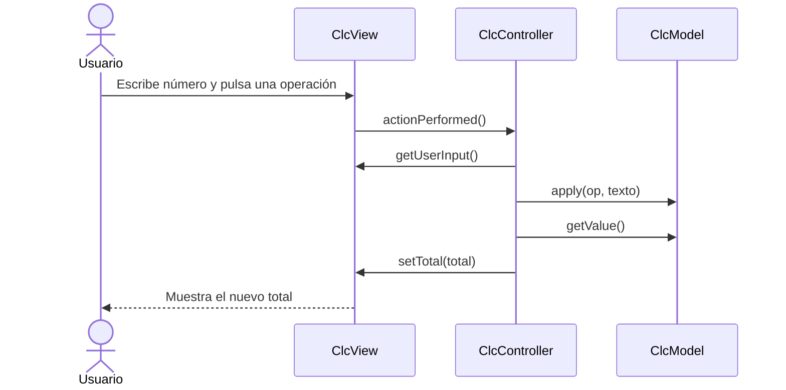
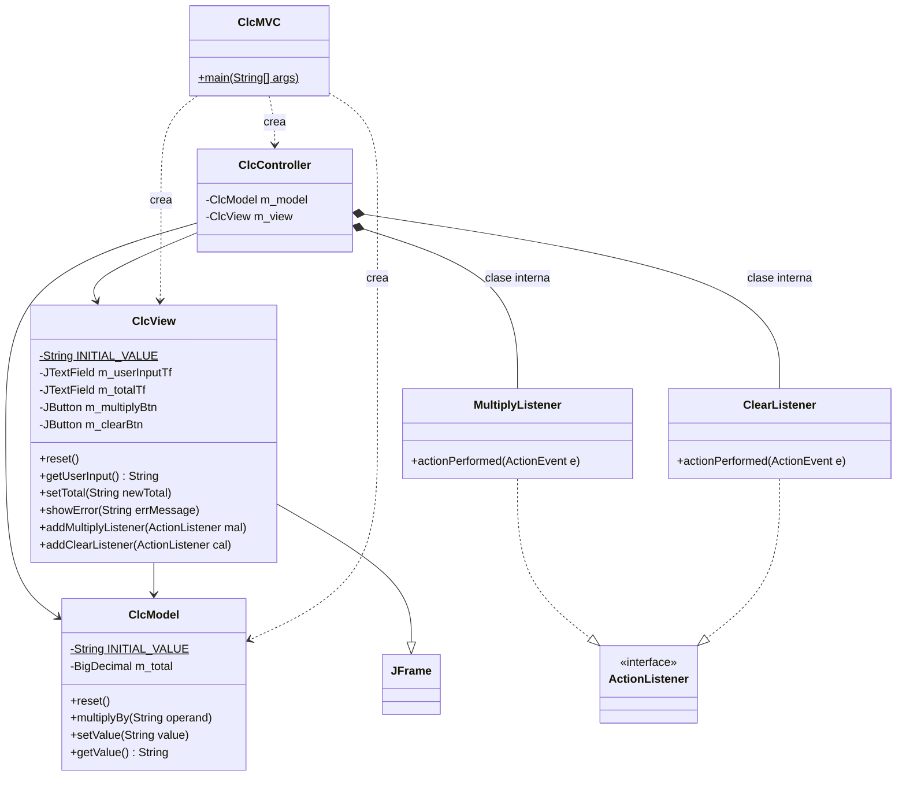
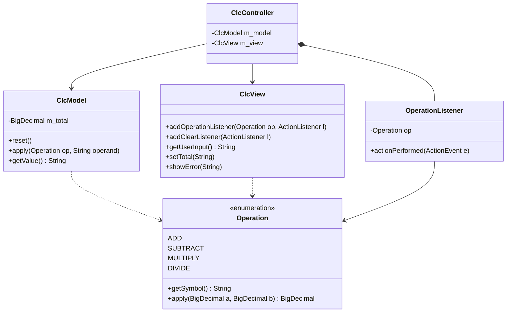

# PD3 – Calculadora con patrón MVC

Práctica de POO basada en el ejemplo de la calculadora MVC (sesión del 10/Nov).
La aplicación es una calculadora en Java Swing que parte de un total en `1` y le aplica suma, resta, multiplicación o división con el número que escribe el usuario.

- **Video explicativo (máx. 5 min):** _pega aquí el URL_
- **Guion del video:** [docs/guion-video.md](docs/guion-video.md)

## Contenido

| Elemento | Dónde |
|---|---|
| Código | [`src/`](src) |
| Documentación | este archivo |
| Diagrama de clases | sección [Diagrama de clases](#diagrama-de-clases) |
| Video | URL arriba |

## Estructura del proyecto

```
PD3/
├─ src/
│  ├─ ClcMVC.java          # Punto de entrada (main)
│  ├─ ClcModel.java        # Modelo: lógica y estado
│  ├─ ClcView.java         # Vista: ventana Swing
│  ├─ ClcController.java   # Controlador: conecta vista y modelo
│  └─ Operation.java       # Enum con las operaciones (+, -, x, /)
├─ docs/
│  └─ guion-video.md
└─ README.md
```

## Cómo ejecutarlo

Requiere JDK 8 o superior.

```bash
cd PD3
mkdir -p bin
javac -d bin src/*.java
java -cp bin ClcMVC
```

## Documentación de lo implementado

### Modelo – `ClcModel`
Guarda el total en un `BigDecimal` (enteros y decimales sin perder precisión) y no sabe nada de la interfaz gráfica.

| Método | Descripción |
|---|---|
| `reset()` | Regresa el total a `1`. |
| `apply(Operation, String)` | Convierte el texto a `BigDecimal` y aplica la operación al total. Lanza `NumberFormatException` si no es un número y `ArithmeticException` si se divide entre cero; en ambos casos el total no cambia. |
| `setValue(String)` | Asigna el total. |
| `getValue()` | Regresa el total como texto con `toPlainString()` (evita notación científica). |

### Vista – `ClcView` (extiende `JFrame`)
Muestra los componentes: campo de entrada, un botón por cada operación (generados recorriendo `Operation.values()`), campo de total no editable y botón **Clear**. No contiene lógica de cálculo; solo expone métodos para que el controlador la use: `getUserInput()`, `setTotal()`, `reset()`, `showError()`, `addOperationListener(Operation, ActionListener)` y `addClearListener()`.

### Controlador – `ClcController`
Recibe el modelo y la vista, y registra un `OperationListener` por cada operación y un `ClearListener` (clases internas):

- `OperationListener`: un solo listener parametrizado con la operación; lee la entrada → `model.apply(op, texto)` → `view.setTotal()`. Si el texto no es válido o se divide entre cero, muestra un mensaje de error.
- `ClearListener`: `model.reset()` y `view.reset()`.

### Arranque – `ClcMVC`
Crea una instancia de cada parte, las conecta y hace visible la ventana.

### Operaciones – `Operation` (enum)
Define `ADD`, `SUBTRACT`, `MULTIPLY` y `DIVIDE`. Cada constante tiene su símbolo (`getSymbol()`) y su propio `apply(BigDecimal, BigDecimal)`. La división usa `MathContext.DECIMAL64` y lanza `ArithmeticException` si el divisor es cero. Agregar una operación nueva solo requiere añadir una constante.

### Flujo de una operación



## Diagrama de clases

### Punto de partida (ejemplo original, solo multiplicación)



### Diseño final (Strategy con `enum`, implementado)



## Estrategia para incrementar las operaciones (manteniendo MVC)

1. **Modelo:** reemplazar `multiplyBy()` por `apply(Operation op, String operand)`. Cada operación se define en un `enum Operation` (suma, resta, multiplicación, división) con su símbolo y su función `BigDecimal → BigDecimal`.
2. **Vista:** crear un botón por cada valor de `Operation.values()` en un ciclo, para que agregar una operación no obligue a escribir más código de interfaz.
3. **Controlador:** un solo `OperationListener` parametrizado con la operación, en lugar de un listener por botón.
4. **Errores:** capturar también `ArithmeticException` (división entre cero) y mostrarla con `view.showError()`.

La vista sigue sin conocer la lógica, el modelo sigue sin conocer Swing y el controlador sigue siendo el único que los conecta.

## ¿Conviene el patrón Command?

El patrón Command encapsula cada acción como un objeto (`interface Command { void execute(); }`) con sus propias clases `AddCommand`, `SubtractCommand`, etc.

**Ventajas**
- Cada operación vive en su propia clase y se agrega sin tocar el controlador (principio abierto/cerrado).
- Permite **deshacer/rehacer** y mantener un **historial** (`undo()`), porque cada comando guarda su estado.
- Facilita registrar, encolar o repetir operaciones (macros).
- Desacopla quien invoca (botón) de quien ejecuta (modelo).

**Desventajas**
- Para operaciones de una sola línea y sin estado, crea muchas clases casi vacías (una por operación) → **sobreingeniería**.
- Aumenta el número de archivos y la complejidad del diagrama.
- Sin requisito de deshacer o historial, no se aprovecha su principal ventaja.

**Conclusión:** para esta calculadora, donde cada operación es solo una función de dos números, Command no es la mejor opción. Se recomienda el `enum Operation` (variante de **Strategy**), que logra la misma extensibilidad con mucho menos código:

| Criterio | Command | `enum` / Strategy |
|---|---|---|
| Agregar operación | Nueva clase + registro en la vista | Nueva constante en el `enum` |
| Clases nuevas | 1 por operación | 0 |
| Undo/redo | Natural | Requiere pila de estados aparte |
| Complejidad | Alta | Baja |

Command pasaría a ser la mejor opción **si se pide historial o deshacer**.

**Otros patrones a considerar**
- **Strategy:** el elegido; cada operación es un algoritmo intercambiable.
- **Observer:** el modelo notifica a la vista cuando cambia el total, en lugar de que el controlador llame a `setTotal()`; es el MVC "completo" y reduce el acoplamiento.
- **Factory / Registro de operaciones:** útil si las operaciones se cargan dinámicamente.

## Autor

Rams3s-R
