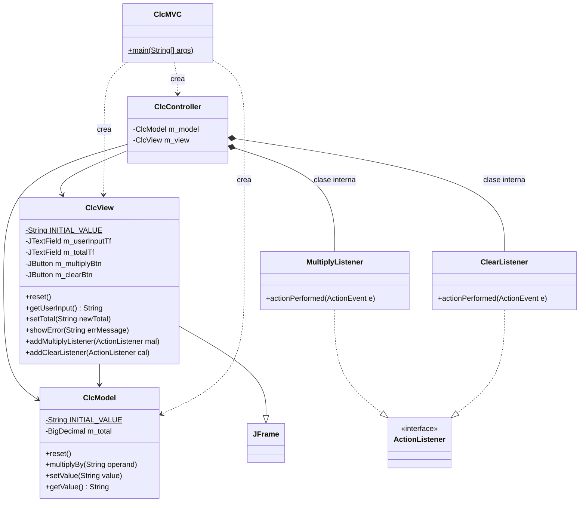
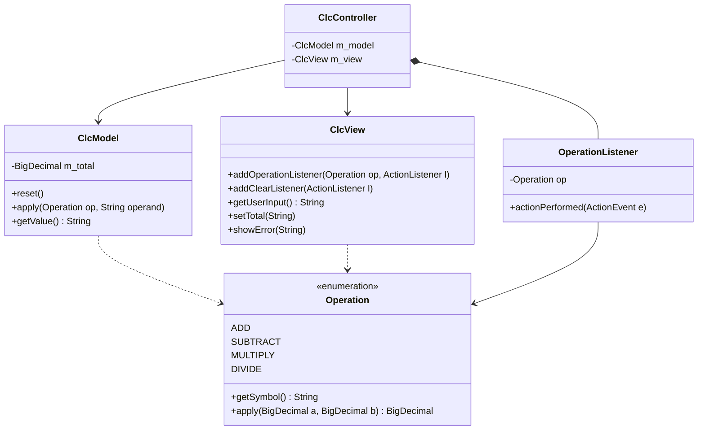

[← Volver al README de PD3](../README.md)

# Diagrama de clases

Los diagramas están escritos en [Mermaid](https://mermaid.js.org/), por lo que GitHub los dibuja automáticamente al abrir este archivo.

## Punto de partida (ejemplo original, solo multiplicación)

## Diseño final (Strategy con `enum`, implementado)

Más detalle sobre por qué se eligió este diseño en [patrones.md](patrones.md).
