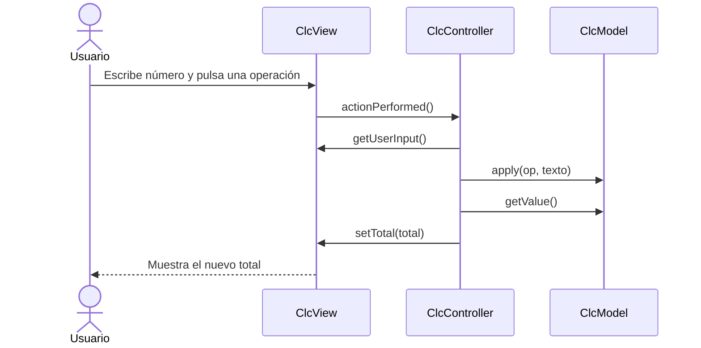

[← Volver al README de PD3](../README.md)

# Documentación de lo implementado

## Modelo – `ClcModel`
Guarda el total en un `BigDecimal` (enteros y decimales sin perder precisión) y no sabe nada de la interfaz gráfica.

| Método | Descripción |
|---|---|
| `reset()` | Regresa el total a `1`. |
| `apply(Operation, String)` | Convierte el texto a `BigDecimal` y aplica la operación al total. Lanza `NumberFormatException` si no es un número y `ArithmeticException` si se divide entre cero; en ambos casos el total no cambia. |
| `setValue(String)` | Asigna el total. |
| `getValue()` | Regresa el total como texto con `toPlainString()` (evita notación científica). |

## Vista – `ClcView` (extiende `JFrame`)
Muestra los componentes: campo de entrada, un botón por cada operación (generados recorriendo `Operation.values()`), campo de total no editable y botón **Clear**. No contiene lógica de cálculo; solo expone métodos para que el controlador la use: `getUserInput()`, `setTotal()`, `reset()`, `showError()`, `addOperationListener(Operation, ActionListener)` y `addClearListener()`.

## Controlador – `ClcController`
Recibe el modelo y la vista, y registra un `OperationListener` por cada operación y un `ClearListener` (clases internas):

- `OperationListener`: un solo listener parametrizado con la operación; lee la entrada → `model.apply(op, texto)` → `view.setTotal()`. Si el texto no es válido o se divide entre cero, muestra un mensaje de error.
- `ClearListener`: `model.reset()` y `view.reset()`.

## Arranque – `ClcMVC`
Crea una instancia de cada parte, las conecta y hace visible la ventana.

## Operaciones – `Operation` (enum)
Define `ADD`, `SUBTRACT`, `MULTIPLY` y `DIVIDE`. Cada constante tiene su símbolo (`getSymbol()`) y su propio `apply(BigDecimal, BigDecimal)`. La división usa `MathContext.DECIMAL64` y lanza `ArithmeticException` si el divisor es cero. Agregar una operación nueva solo requiere añadir una constante.

## Flujo de una operación

