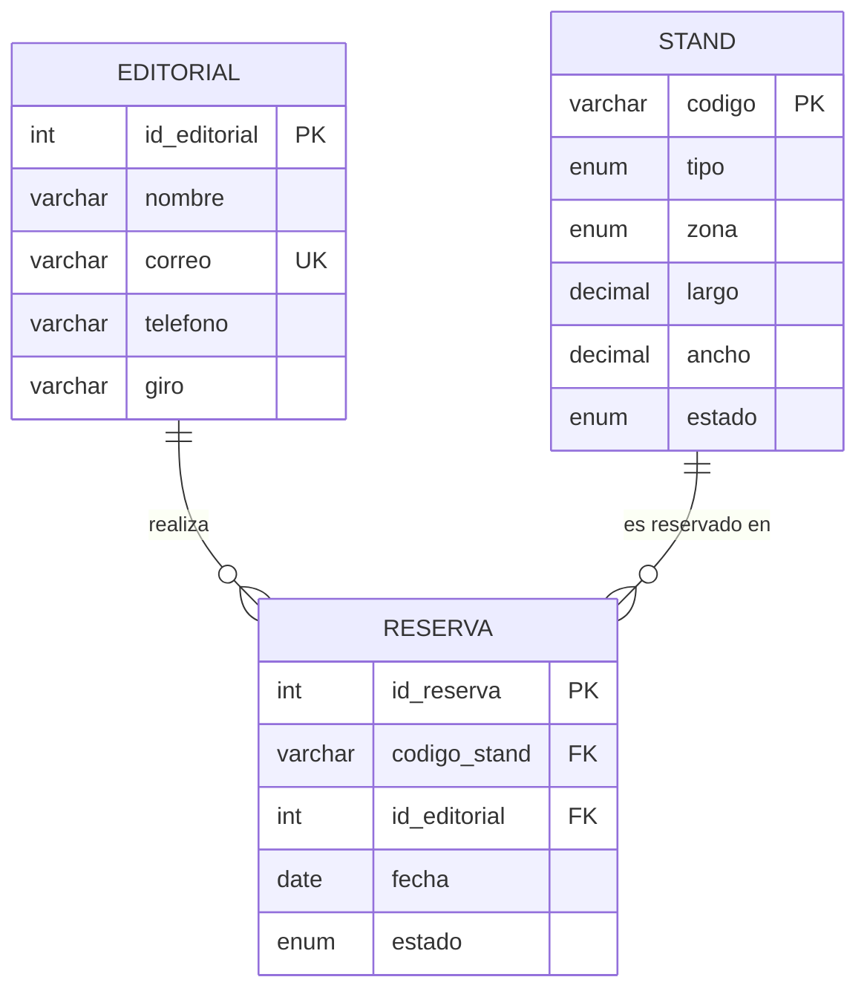

# Diagrama Entidad-Relación

## Relaciones
- Una **editorial** puede hacer muchas **reservas** (1:N).
- Un **stand** puede aparecer en muchas **reservas** a lo largo del tiempo (1:N), por ejemplo una cancelada y luego otra confirmada.
- **Reserva** es la tabla intermedia que une Editorial y Stand.
